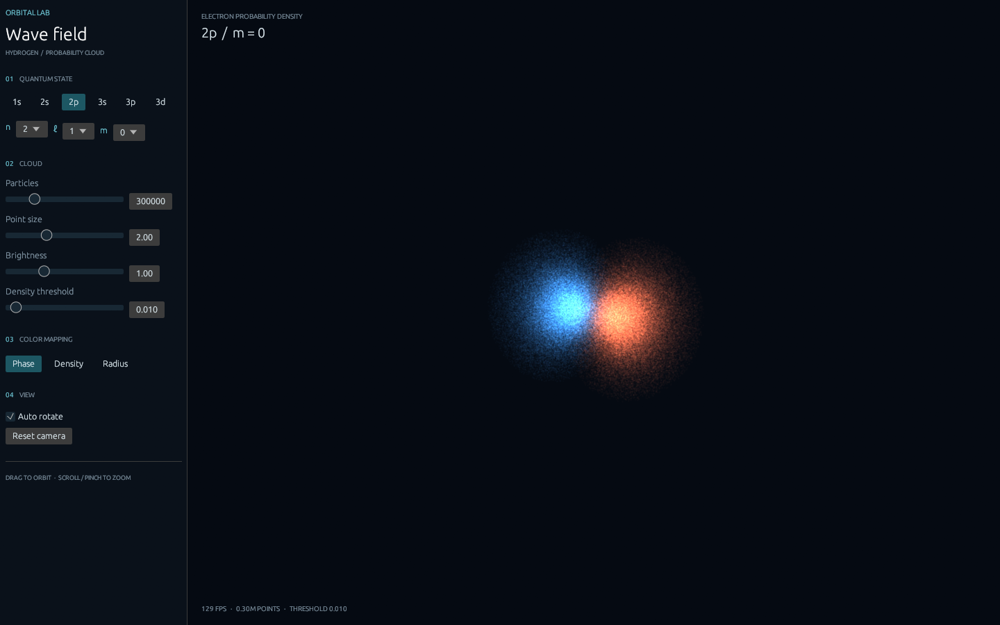
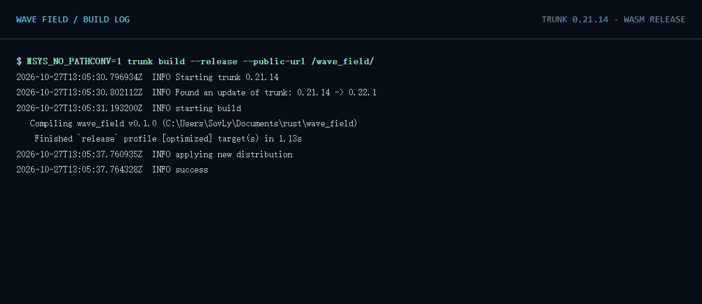

# Wave Field

An interactive hydrogen-orbital instrument built with **Rust, egui, egui-wgpu and browser WebGPU**. A compute shader samples the electron probability density; the GPU renders the resulting cloud as additive particles.



The interface uses a restrained dark palette, fine dividers and cool instrument-like accents to leave the phase-colored cloud as the focus. [3d screenshot](assets/3d-screenshot.png) · [Mobile-size screenshot](assets/mobile-screenshot.png)

## Controls

Choose `n`, `ℓ` and `m`, or use the six orbital presets. Adjust particle count, size, brightness, density threshold and color mapping in the panel. Drag to orbit, scroll or pinch to zoom, and use **Reset camera** to return to the starting view. On narrow screens open **Controls** in the header. Automatic rotation can be disabled.

## Physics and implementation

For a hydrogen atom, ψₙₗₘ(r,θ,φ) = Rₙₗ(r)Yₗₘ(θ,φ), and the probability density is |ψₙₗₘ|². `src/orbital_compute.wgsl` uses rejection sampling of r²|Rₙₗ|² and |Yₗₘ|², independently, then combines the radius and direction. It covers every valid n ≤ 3 and uses Bohr radii, a finite radius of 40 a₀ and bounded rejection attempts; unsuccessful samples are not drawn. The displayed m components use **real tesseral harmonics**: nonzero m represents a real linear combination of the conventional complex ±m eigenfunctions, rather than a pure complex Lz eigenstate. Phase colors indicate the sign of this real wavefunction; radial and angular nodes remain visible. This is a visualization of a probability distribution, not an electron trajectory.

The samples are generated on the GPU when the quantum state or particle count changes, and are retained while the camera or appearance changes. To avoid saturating an 8-bit additive target, the renderer deterministically thins the *displayed* samples at high counts or small viewport sizes; the requested count is still generated and stored. Each shell is scaled for viewing, so screen size is not a comparison of physical orbital radii. The density threshold is relative to an orbital-specific radial bound, not an absolute probability density.

## Build and run

Install stable Rust, the WASM target and Trunk:

```sh
rustup target add wasm32-unknown-unknown
cargo install trunk --version 0.21.14 --locked
trunk serve
```

Open the address printed by Trunk. To build a GitHub Pages project site:

```sh
trunk build --release --public-url /REPOSITORY_NAME/
```

Replace `REPOSITORY_NAME` with the repository name. The output is `dist/`. In Git Bash/MSYS on Windows, prevent automatic conversion of `/REPOSITORY_NAME/` to a Windows filesystem path:

```sh
MSYS_NO_PATHCONV=1 trunk build --release --public-url /wave_field/
```

## GitHub Pages

Set **Settings → Pages → Source** to **GitHub Actions**, then push to `master` or `main`, or manually run `.github/workflows/deploy.yml`. It installs the WASM target and Trunk, builds with `--public-url /<repository>/`, uploads `dist/`, and deploys with the official Pages actions. A user/organization root site needs `/` instead. The expected project URL is <https://sovlyn.github.io/wave_field/>; deployment and public availability must be verified separately.

## Compatibility

WebGPU requires a supported browser and GPU/driver, hardware acceleration, and a secure context (HTTPS or localhost). Support varies across platforms, especially on mobile. The page displays a message if WebGPU is unavailable or device initialization fails; there is no WebGL fallback. Browser warnings can still originate from the browser or GPU driver.

## Verification and acceptance checklist

- [x] Rust/WASM release build with Trunk; `cargo check` for WASM and native also succeeded.
- [x] WebGPU compute shader and egui-wgpu render callback implemented; n = 1, 2, 3, all legal ℓ and m, and six presets implemented.
- [x] Local Chrome WebGPU test at `/wave_field/`: cloud visible; six presets, a color mode, density threshold, 1,000,000-particle setting and mouse drag exercised. No unhandled exceptions or asset 404s observed. Chrome emitted browser-generated warnings about preload integrity and Windows power preference.
- [x] Desktop and emulated narrow viewport screenshots captured; unavailable-adapter message observed in a separate browser configuration.
- [ ] Test every m component and physical touch gestures on real mobile hardware; independently validate the numerical distribution and performance across devices.
- [ ] Publish with GitHub Pages and verify the actual public URL and asset requests.

### Build log

The following image is a browser rendering of the [captured local build log](assets/build-log.txt), not a screenshot of a terminal window:



## Source layout

- `src/main.rs` — WASM startup and initialization error handling.
- `src/app.rs` — egui controls, responsive layout and camera interactions.
- `src/gpu.rs` — wgpu buffers, pipelines and egui paint callback.
- `src/orbital_compute.wgsl` — GPU orbital sampling.
- `src/orbital_render.wgsl` — GPU point-sprite rendering and color mapping.
- `index.html` — Trunk entry page and WebGPU fallback.
- `.github/workflows/deploy.yml` — GitHub Pages build and deployment.
